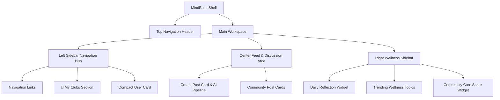

# 🌟 MindEase Community Overview

## 1. System Vision & Core Intent

The MindEase Community Module is the flagship feature of MindEase 2.0. It is engineered as a **private, encrypted, mental wellness sanctuary** where users can heal, connect, and grow through meaningful conversations and shared creative hobbies.

> **User Sentiment Target**:
> *"I came here to heal, connect, and grow—not to compete."*

### What MindEase Community IS:
- A safe space for peer support, vulnerability, and mutual encouragement.
- A hobby-driven community powered by 4 primary clubs: 📚 Book Club, 🎵 Music Club, 📸 Photography Club, and 🧘 Yoga Club.
- A privacy-first anonymous platform where pseudonymous avatars protect user identity.
- An AI-shielded environment where posts pass through real-time safety classification.

### What MindEase Community IS NOT:
- NOT an Instagram clone.
- NO short-form video reels or dopamine traps.
- NO like counts, view counters, or follower/following leaderboards.
- NO public user popularity scores or influencer algorithms.

---

## 2. Architectural Blueprint & Layout Breakpoints

### Layout Responsive Adaptation

1. **Desktop (>= 1280px)**:
   - Full 3-column layout.
   - Left Sidebar: 280px fixed width, sticky positioning.
   - Center Feed: Flexible 600px - 720px width.
   - Right Wellness Sidebar: 340px fixed width, sticky positioning.

2. **Tablet (768px - 1279px)**:
   - 2-column layout.
   - Left Sidebar collapses into an expandable drawer accessible via hamburger menu.
   - Center Feed takes main column.
   - Right Wellness Sidebar moves into a collapsible drawer or top tab view.

3. **Mobile (< 768px)**:
   - Single-column layout.
   - Fixed Bottom Navigation Bar (Home Feed, Explore, Create Post, Clubs, Profile).
   - Top Header retains Community Search, Notifications bell, and Avatar.

---

## 3. Design System & Aesthetic Tokens

- **Palette**:
  - `bg-primary`: `#0B1220`
  - `bg-secondary`: `#111827`
  - `bg-card`: `#182235`
  - `accent-sky`: `#7DD3FC`
  - `accent-mint`: `#6EE7B7`
  - `accent-lavender`: `#B79CFF`
  - `accent-beige`: `#FDE68A`
- **Typography**: Inter / Outfit for clean readability, serif headings for quotes and reflections.
- **Card Spacing**: 20px to 24px vertical margins between post cards.
- **Glassmorphism**: Soft background blur (`backdrop-blur-md`), subtle borders (`border-white/10`), ambient radial glow overlays (`#8A5CFF/15`).
