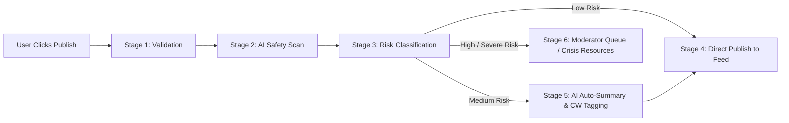

# ✍️ Create Post Card & AI Safety Pipeline

## 1. UI Components & Layout

The Create Post card sits prominently at the top of the Center Feed.

```text
+-----------------------------------------------------------------------+
|  [Avatar]   "Share a thought or ask a question..."                   |
|                                                                       |
|  [ Expandable Text Area - Auto-resizing up to 500px ]                 |
|                                                                       |
|  [📷 Add Image]  [😊 Add Mood]  [# Add Topic]  [🌿 Select Club]     |
|                                                                       |
|  [🔒 Post Anonymously Toggle: ON]   [Character Count: 140 / 2000]    |
|                                                                       |
|  🛡️ AI Safety Notice: "Your post is protected by MindEase AI.          |
|     Harmful or triggering content will be scanned before posting."    |
|                                                                       |
|                                                     [ Post Button ]   |
+-----------------------------------------------------------------------+
```

### Element Specs:
- **Profile Avatar**: Displays current user's anonymous persona avatar.
- **Input Field**: Auto-expanding textarea with smooth height transition.
- **Toolbar Buttons**:
  - 📷 **Add Image**: Secure file upload (PNG/JPEG/WebP, max 5MB) with privacy EXIF metadata stripping.
  - 😊 **Add Mood**: Mood dropdown selector (Calm, Anxious, Hopeful, Overwhelmed, Grateful, Reflective).
  - `#` **Add Topic**: Topic tag selector (#Mindfulness, #AnxietyRelief, #SleepTips, #WorkLifeBalance, #Journaling).
  - 🌿 **Select Club**: Optional dropdown to post directly into 📚 Book Club, 🎵 Music Club, 📸 Photography Club, or 🧘 Yoga Club.
- **Anonymous Toggle**: Default ON. When enabled, displays pseudonymous nickname (`CalmSoul21`).
- **Character Counter**: Live indicator up to 2,000 characters.
- **AI Safety Notice**: Clear reminder that posts are scanned for safety.

---

## 2. Mandatory 6-Stage AI Safety Pipeline

Every post must pass through the pipeline before appearing in the public feed:



1. **Stage 1 (Client Validation)**: Verifies text length, image dimensions, and sanitizes input.
2. **Stage 2 (AI Safety Scan)**: Analyzes content for toxicity, hate speech, self-harm, harassment, or severe crisis signals.
3. **Stage 3 (Risk Classification)**:
   - `SAFE`: Approved instantly.
   - `NEEDS_CW`: Approved with Content Warning fold.
   - `HIGH_RISK`: Sent to Moderator Queue.
   - `CRISIS`: Triggers immediate pop-up with crisis hotline resources and holds post for urgent review.
4. **Stage 4 (Publish)**: Emits real-time Supabase payload to community feed.
