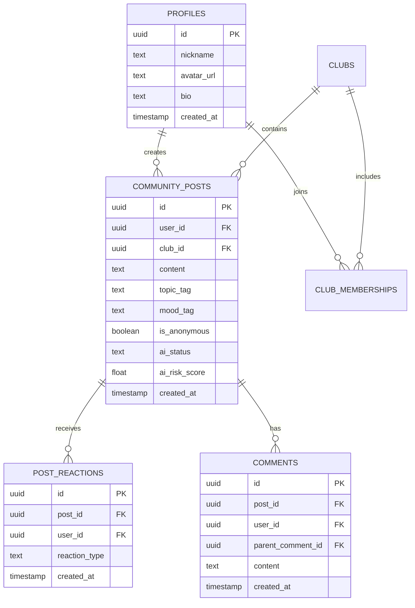

# 🗄️ Database Schema & Supabase Architecture

## 1. Relational Entity Relationship Diagram



---

## 2. Table Definitions & Indexes

### `community_posts`
```sql
CREATE TABLE IF NOT EXISTS public.community_posts (
  id UUID PRIMARY KEY DEFAULT gen_random_uuid(),
  user_id UUID NOT NULL REFERENCES auth.users(id) ON DELETE CASCADE,
  club_id UUID REFERENCES public.clubs(id) ON DELETE SET NULL,
  content TEXT NOT NULL,
  image_url TEXT,
  topic_tag TEXT NOT NULL,
  mood_tag TEXT,
  is_anonymous BOOLEAN DEFAULT TRUE,
  ai_status TEXT DEFAULT 'PENDING', -- PENDING, APPROVED, NEEDS_CW, REJECTED
  ai_risk_score FLOAT DEFAULT 0.0,
  created_at TIMESTAMPTZ DEFAULT NOW()
);

CREATE INDEX idx_community_posts_club ON public.community_posts(club_id);
CREATE INDEX idx_community_posts_topic ON public.community_posts(topic_tag);
CREATE INDEX idx_community_posts_status ON public.community_posts(ai_status);
```

### `post_reactions`
```sql
CREATE TABLE IF NOT EXISTS public.post_reactions (
  id UUID PRIMARY KEY DEFAULT gen_random_uuid(),
  post_id UUID NOT NULL REFERENCES public.community_posts(id) ON DELETE CASCADE,
  user_id UUID NOT NULL REFERENCES auth.users(id) ON DELETE CASCADE,
  reaction_type TEXT NOT NULL, -- helpful, relate, encouraged, thank_you
  created_at TIMESTAMPTZ DEFAULT NOW(),
  CONSTRAINT unique_user_post_reaction UNIQUE (post_id, user_id, reaction_type)
);
```
