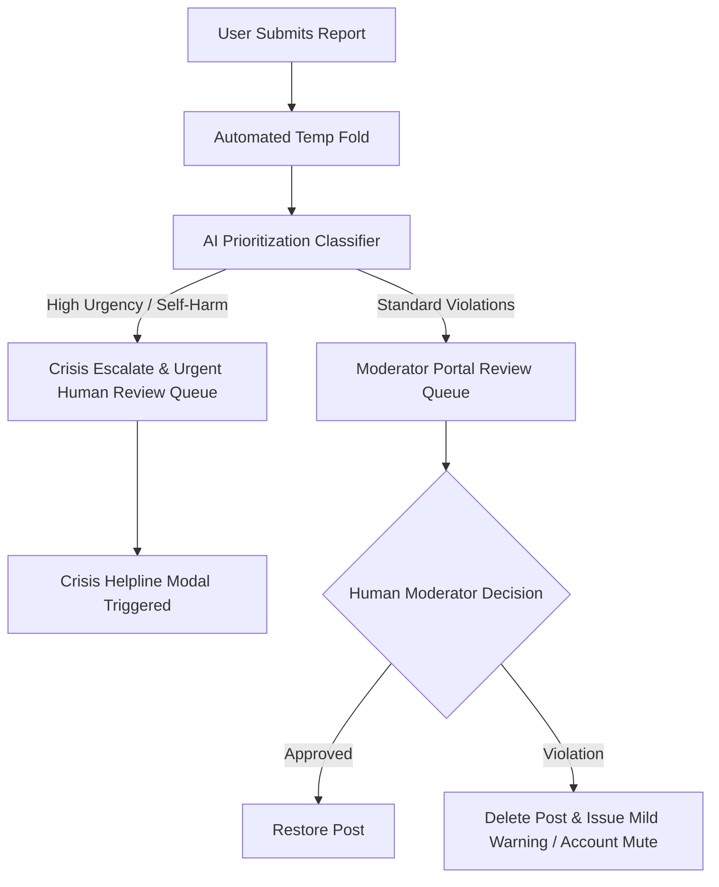

# 🚩 Report & Safety System Specification

## 1. User Reporting Workflow

Every post, comment, and profile in MindEase includes a discreet 🚩 **Report** button in its three-dot action menu.

### Report Categories:
1. `Harassment or Bullying`
2. `Hate Speech or Intolerance`
3. `Self-Harm or Suicide Signals`
4. `Medical Misinformation`
5. `Spam or Unsolicited Promotion`
6. `Privacy Violation / Doxxing`

---

## 2. Escalation & Processing Matrix

- **Immediate Action**: If a post accumulates 3 user reports within 1 hour, it is automatically hidden from public feeds while awaiting human moderator review.
- **Reporter Anonymity**: The identity of the reporting user is strictly confidential and never revealed.
- **Reporter Confirmation**: The reporting user receives a gentle confirmation: *"Thank you for keeping our sanctuary safe. Our team has received your report."*
